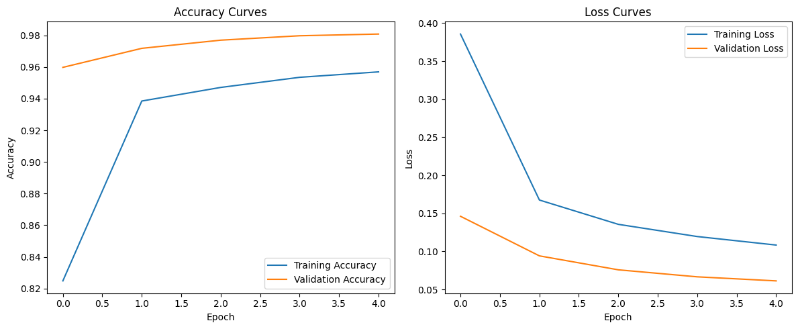
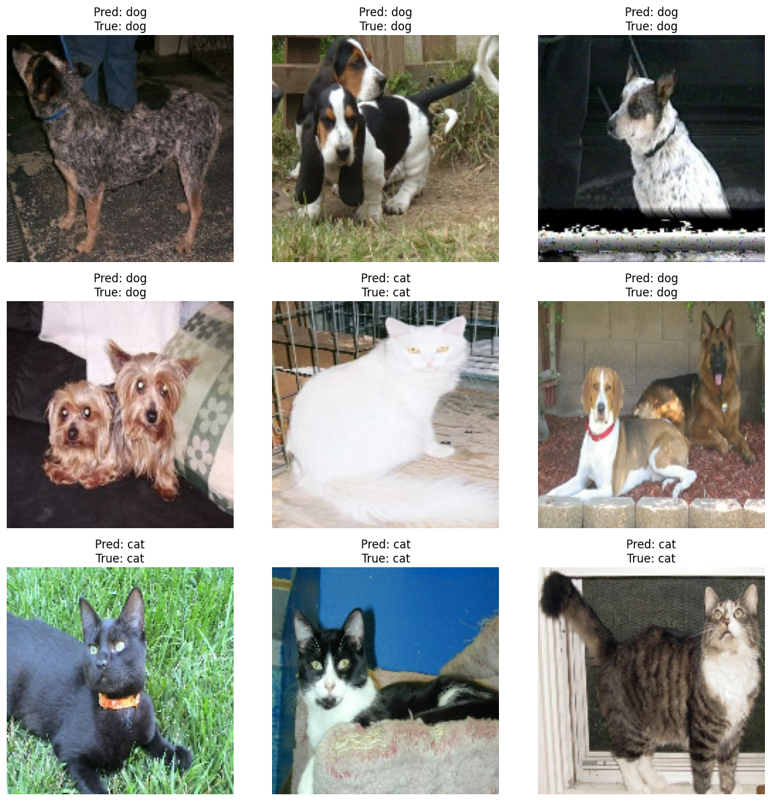
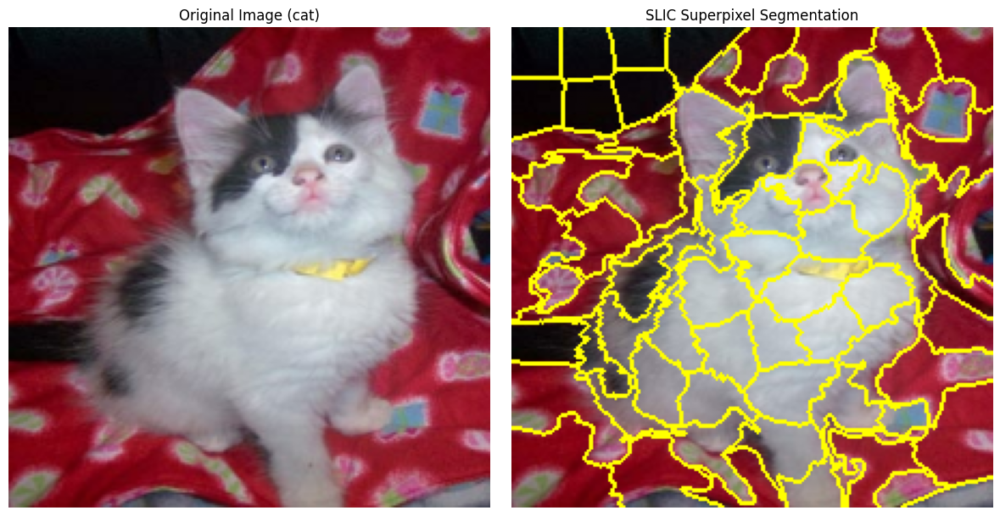

# Computer Vision — Transfer Learning and Image Analysis

Final project for the **Computer Vision** course, MSc in Artificial Intelligence
and Optimization, Faculty of Information Technology, Polytechnic University of
Tirana — 2026.

Two things in one notebook: a binary image classifier built by transfer learning
from a pre-trained convolutional network, and an unsupervised segmentation of the
same images into superpixels. The first asks whether features learned on one
dataset transfer to another; the second asks how far you can get on an image with
no labels at all.

## The classifier

**Data.** The Cats vs Dogs dataset, 23,262 valid RGB images, split 80/20 into
training and test sets. The images vary widely in pose, scale, lighting and
background, which is what makes the task non-trivial despite the simple label.

**Approach.** MobileNetV2, pre-trained on ImageNet, is used as a frozen feature
extractor: its original classification layer is removed and replaced with global
average pooling, dropout at 0.3, and a single sigmoid unit. Only the new head is
trained. Images are resized to 160×160 and passed through MobileNetV2's own
preprocessing; random flips, rotations and zooms are applied to the training set.
Trained with Adam at a learning rate of 1e-4 against binary cross-entropy, for
five epochs.

**Results.**

| | Accuracy | Loss |
|---|---|---|
| Training (final epoch) | 95.7% | — |
| Test | 98.09% | 0.0612 |



Training and validation loss both fall throughout, and validation accuracy sits
*above* training accuracy at every epoch — which is what you expect here rather
than a sign of anything wrong: augmentation is applied only to the training set,
so the training batches are harder than the test ones. No overfitting is visible
over five epochs.

Worth being clear about what this result does and does not show. Cats vs Dogs
with a frozen ImageNet backbone is a well-trodden exercise and ~98% is the
expected outcome, not a strong one. What the project demonstrates is the method —
freezing a backbone, replacing the head, augmenting, and reading the curves —
rather than a competitive result.



## The segmentation

The same images are then segmented with **SLIC** (Simple Linear Iterative
Clustering), which groups neighbouring pixels of similar colour into superpixels:
100 segments, compactness 10, on a 224×224 resize.



The boundaries follow changes in colour and texture, so the animal and the
background end up represented by separate groups of regions. SLIC does no
recognition of its own — it is a preprocessing step, reducing an image from
thousands of pixels to a hundred coherent regions that a later stage can work on.

## Running it

```bash
pip install -r requirements.txt
jupyter notebook notebooks/transfer_learning_and_segmentation.ipynb
```

The dataset is downloaded automatically by `tensorflow_datasets` on first run
(roughly 800 MB) and is not stored in this repository. Training the five epochs
took about 50 minutes on CPU; a GPU reduces this considerably.

The notebook is committed with its outputs intact, so it can be read on GitHub
without running anything.

## Layout

```
notebooks/   the project notebook, outputs included
figures/     figures extracted from the notebook, used above
```

## Tools

Python, TensorFlow/Keras, TensorFlow Datasets, scikit-image, NumPy, Matplotlib.
